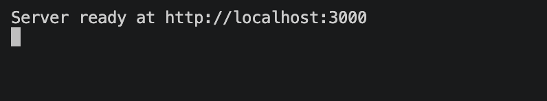
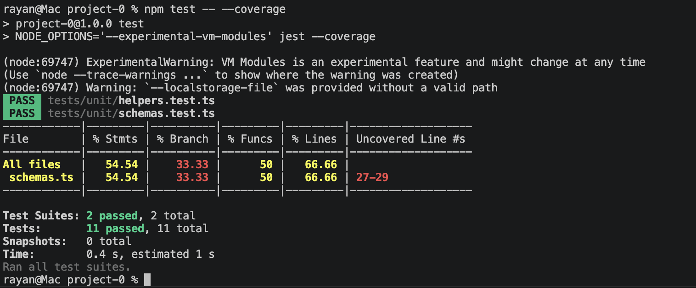
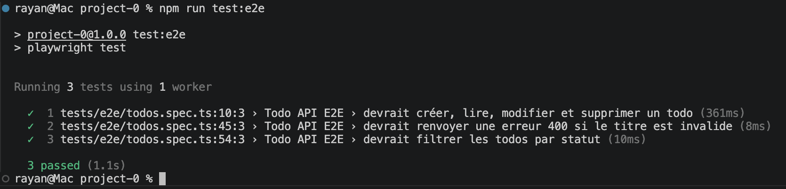
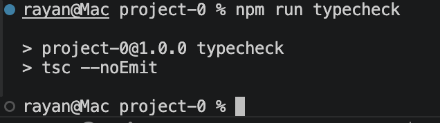
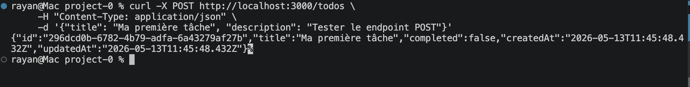
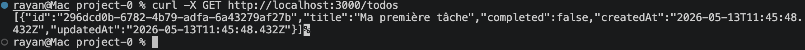
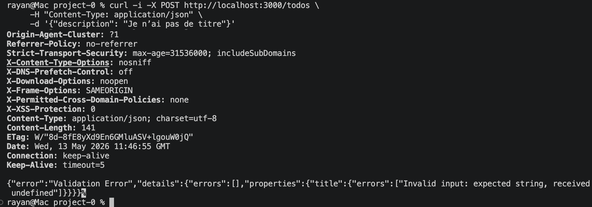
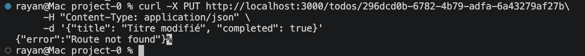
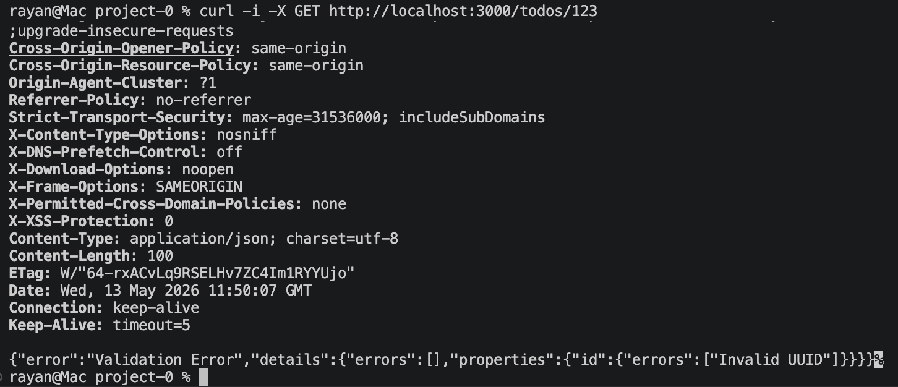

###  Project 0 — Vanilla Todo HTTP API

API REST de gestion de tâches développée avec Node.js et TypeScript. Ce projet implémente un CRUD complet avec validation de données, gestion rigoureuse des erreurs HTTP et tests automatisés.

## Installation

```bash
# Installation des dépendances
npm install

# Lancement du serveur en mode développement
npm run dev

```

## Usage Examples

### 1. Create a todo

```bash
curl -X POST http://localhost:3000/todos \
     -H "Content-Type: application/json" \
     -d '{"title": "Projet 0", "description": "Finaliser le README"}'

```

### 2. List todos

```bash
curl -X GET http://localhost:3000/todos

```

### 3. Update a todo

```bash
curl -X PUT http://localhost:3000/todos/{id} \
     -H "Content-Type: application/json" \
     -d '{"completed": true}'

```

## Test & verification de FR

Cette section regroupe les preuves de succès pour chaque exigence fonctionnelle et technique du projet via des blocs escamotables.

### 1. Demarrage du serveur

Commande : `npm run dev`
Result : 
<details>

  <summary>Cliquez pour voir les resultats</summary>

  

</details>

### 2. Resultats des Tests : Unitaires (Jest) & Coverage

Commande : `npm test -- --coverage`

Result : 
<details>

  <summary>Cliquez pour voir les resultats</summary>

  

</details>

### 3. Resultats des Tests : E2E

Commande : `npm run test:e2e`
Result : 
<details>

  <summary>Cliquez pour voir les resultats</summary>

  

</details>

### 4. Verification du typage

Commande : `npm run typecheck`

Result : 
<details>

  <summary>Cliquez pour voir les resultats</summary>

  

</details>

### 5. Analyse statique (Lint)

Commande : `npm run lint`

### 6. FR-1 : Creation de ressource (POST)

Commande : `POST /todos`

Result : 
<details>

  <summary>Cliquez pour voir les resultats</summary>

  

</details>

### 7. FR-1 : Recuperation des donnees (GET)

Commande : `GET /todos`

Result : 
<details>

  <summary>Cliquez pour voir les resultats</summary>

  

</details>

### 8. FR-2 : Erreur de validation (400)

Commande : `POST /todos` avec corps invalide.

Result : 
<details>

  <summary>Cliquez pour voir les resultats</summary>

  

</details>

### 9. FR-1 : Mise a jour et Suppression (PUT/DELETE)

Commandes de modification et retrait de ressource.

Result : 
<details>

  <summary>Cliquez pour voir les resultats</summary>

  

</details>

### 10. FR-3 : Gestion du 404 (Not Found)

Commande : `GET /todos/unknown-id`

Result : 
<details>

  <summary>Cliquez pour voir les resultats</summary>

  

</details>


## API Reference

| Method | Endpoint | Description |
| --- | --- | --- |
| `GET` | `/todos` | Récupère toutes les tâches. |
| `GET` | `/todos/:id` | Récupère une tâche par son identifiant unique. |
| `POST` | `/todos` | Crée une nouvelle tâche (Title requis). |
| `PUT` | `/todos/:id` | Met à jour une tâche existante. |
| `DELETE` | `/todos/:id` | Supprime une tâche définitivement. |

## HTTP Response Codes

| Code | Meaning | Context |
| --- | --- | --- |
| 200 | OK | Succès de la requête. |
| 201 | Created | Ressource créée avec succès. |
| 400 | Bad Request | Erreur de validation des données envoyées. |
| 404 | Not Found | La ressource demandée n'existe pas. |
| 500 | Internal Server Error | Erreur imprévue du serveur. |

## License

MIT License - Copyright (c) 2026 Rayan Junior Fogue
